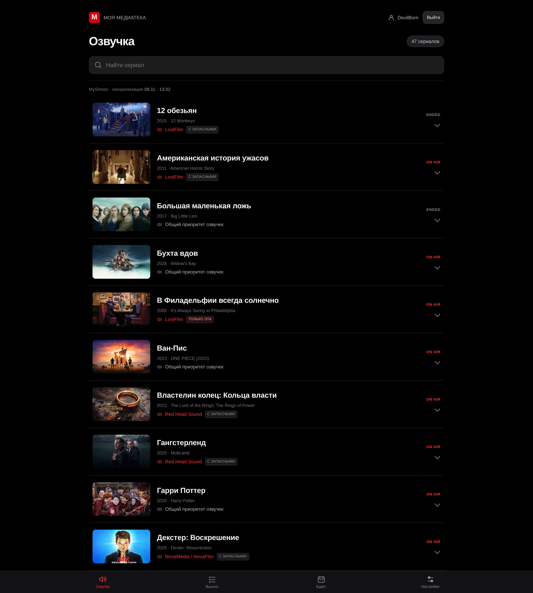
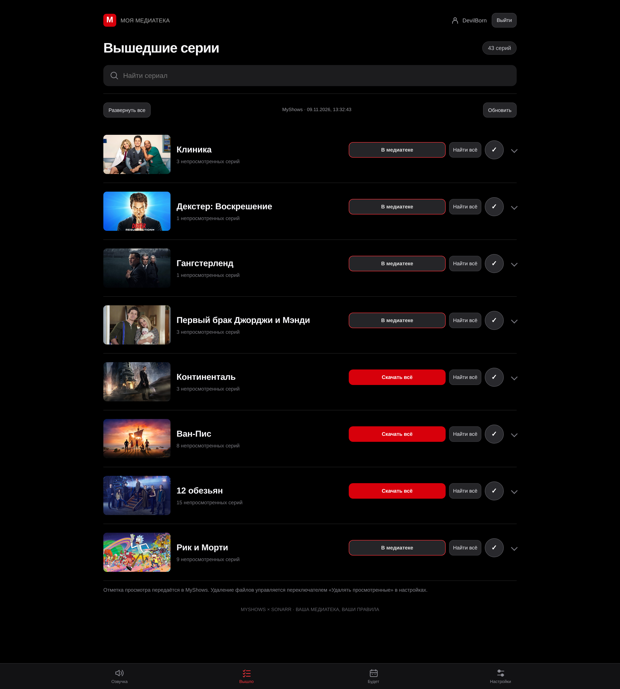
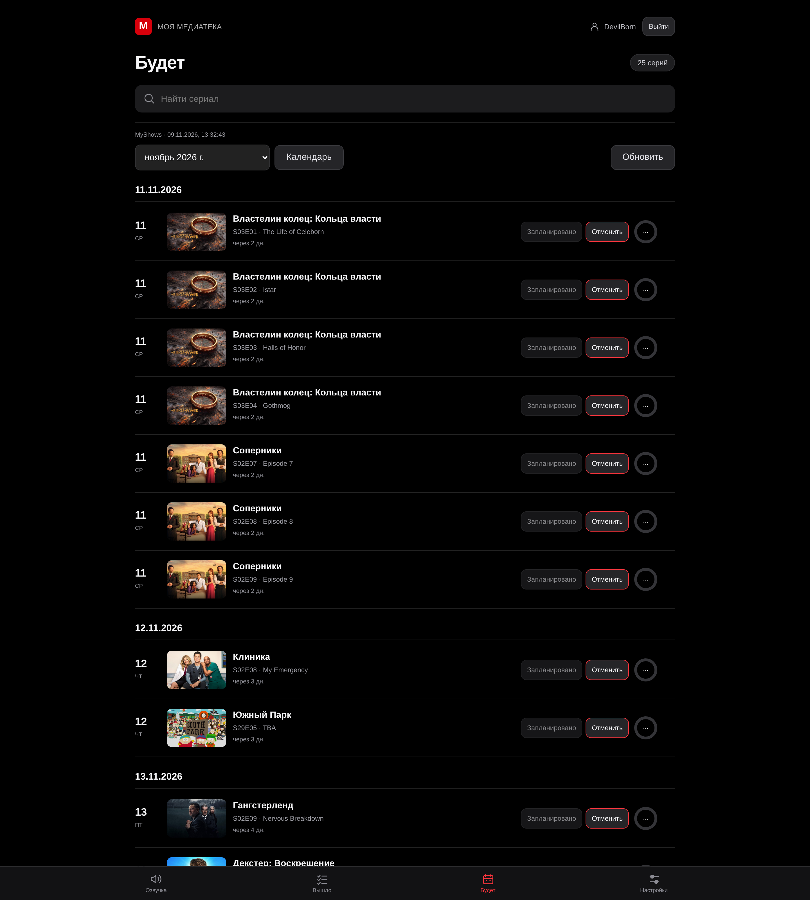
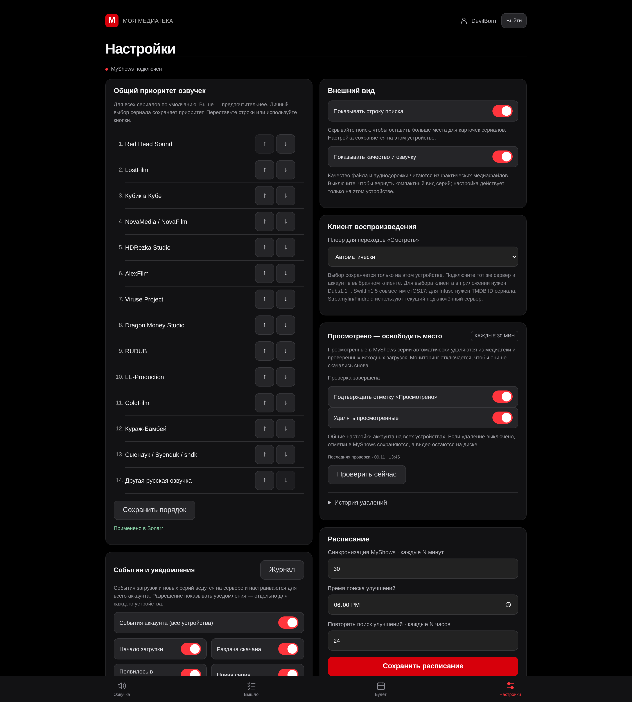

# dubs-media-stack

**Открытый проект под лицензией MIT** — [chelaxian/dubs-media-stack](https://github.com/chelaxian/dubs-media-stack).
Репозиторий можно свободно клонировать, использовать и форкать; условия — в [LICENSE](LICENSE).

Личный медиастек для домашних сериалов с обязательной русской озвучкой:
**MyShows (список «смотрю») → Sonarr → Transmission → Jellyfin**, запросы через **Seerr**,
плюс собственная **веб-панель на systemd** (нативно, без Docker) для управления политиками
озвучки и эпизодами. Продукты: **панель + Docker-стек готовых образов**.

Поддерживаются **Debian 12/13 и Ubuntu 24.04** (нативная панель), Docker с Compose v2
устанавливается инсталлятором. Обновления Proxmox VE и развёртывание прокси/VPN на хосте
в проект не входят и не выполняются.

## Скриншоты

| Озвучка | Вышло |
|---|---|
|  |  |

| Будет | Настройки |
|---|---|
|  |  |

## Что умеет панель

- Три основных вкладки — **Озвучка / Вышло / Будет (календарь)** — плюс «Настройки»;
  адаптивный тёмно-красный интерфейс, отдельный режим для ТВ-приставок.
- Отметки «просмотрено» через ваш аккаунт MyShows; поиск с прогрессом, фильтры и сортировка.
- Заказ эпизодов автоматически и вручную; пачки сезонов — строго по файлам сезона;
  массовый заказ и отмена, отмена отдельного эпизода не трогает остальные.
- Зелёная кнопка «смотреть» — глубокие ссылки в клиент Jellyfin (Findroid, Swiftfin,
  Fladder, Streamyfin, Infuse, браузер).
- По-сериальные политики: выбранная студия озвучки, режимы «fallback» и «strict».
- Политики качества: русский язык обязателен, только 1080p/2160p, минимум 1 сид;
  выбор — качество, затем озвучка и сиды (подробнее: [docs/policy-scheduling.md](docs/policy-scheduling.md)).
- Ежедневное обновление качества в 18:00 по локальной зоне, только для непросмотренного;
  без деградации озвучки/качества; остановка на 2160p+основной озвучке.
- Объединение дополнительных трекеров для публичных торрентов по точному infohash;
  работает и для загрузок, добавленных напрямую в Transmission.
- Очистка просмотренных файлов — **явный opt-in**, по умолчанию выключена.

## Состав стека (официальные образы)

| Сервис | Образ | Порт (только loopback) |
|---|---|---|
| Jellyfin | `jellyfin/jellyfin` | 127.0.0.1:8096 |
| Seerr | `ghcr.io/seerr-team/seerr` (`/app/config`) | 127.0.0.1:5055 |
| Sonarr | `lscr.io/linuxserver/sonarr` | 127.0.0.1:8989 |
| Radarr (опц.) | `lscr.io/linuxserver/radarr` | 127.0.0.1:7878 |
| Lidarr (опц., музыка) | `lscr.io/linuxserver/lidarr` | 127.0.0.1:8686 |
| Transmission | `lscr.io/linuxserver/transmission` | 127.0.0.1:9091 |
| Prowlarr | `lscr.io/linuxserver/prowlarr` | 127.0.0.1:9696 |
| Jackett (профиль extras) | `lscr.io/linuxserver/jackett` | 127.0.0.1:9117 |
| FlareSolverr (профиль extras) | `flaresolverr/flaresolverr` | 127.0.0.1:8191 |

Наружу публикуется только peer-порт Transmission **51413 TCP/UDP**. Веб-сервисы —
через reverse proxy с TLS ([docs/security-reverse-proxy.md](docs/security-reverse-proxy.md)).
Панель: `127.0.0.1:9192` (HTTP), `9193` (TLS), фид MyShows для Sonarr: `127.0.0.1:9191`.

## Быстрый старт

**Интерактивный визард:** из клона или распакованного исходного релиза запустите
`sudo ./install.sh`; обновление с резервной копией — `sudo ./update.sh`.
Просмотр плана без изменений — `./install.sh --plan`.
Подробности: [установка одной командой](docs/quickstart.md).

В «Настройках» можно менять общий порядок озвучек перетаскиванием или кнопками
↑/↓ и сохранять его для всех устройств. Личный выбор студии для сериала остаётся
приоритетным. В списке приложений автоматически остаётся последняя версия каждого
клиента и платформы.

Порядок шагов важен: `.env` заполняется **до** `install`, sentinel «вооружается»
**после** личной проверки монтирования. Все команды идемпотентны; инсталлятор
честно печатает оставшиеся шаги оператора. Подробности — [docs/installation.md](docs/installation.md).

```bash
# 0. Требования: Debian 12/13 или Ubuntu 24.04, git и python3.

# 1. Приватный репозиторий: нужно приглашение и авторизованный git.
git clone https://github.com/chelaxian/dubs-media-stack.git
cd dubs-media-stack

# 2. Создайте и заполните compose/.env ДО install — абсолютные пути обязательны;
#    сразу приватным (0600):
install -m 0600 compose/.env.example compose/.env
editor compose/.env    # MEDIA_ROOT=/srv/dubs/media  DUBS_DATA_ROOT=/srv/dubs/data
                       # PUID, PGID, TZ (пути ниже — пример, выберите свои)

# 3. Осмотр (read-only; ничего не меняет):
python3 -m installer plan --no-mutate
python3 -m installer doctor

# 4. Хранилище. Локальный каталог — создайте явным mkdir; внешний диск —
#    смонтируйте и проверьте (findmnt). Только затем один раз вооружите
#    sentinel: путь впишите БУКВАЛЬНО, тот же, что в MEDIA_ROOT
#    (не через $MEDIA_ROOT — shell-переменная не установлена, и файл
#    молча создастся в корне /):
sudo mkdir -p /srv/dubs/media                  # только для локального пути
findmnt /srv/dubs/media                        # для внешнего диска — проверка
sudo install -m 0644 /dev/null /srv/dubs/media/.dubs-storage-ok

# 5. Установка (root): зависимости, пользователи панели, каталоги, юниты;
#    только ОТСТУТСТВУЮЩИЕ сервисы поднимаются через compose, существующие
#    (и принятые внешние) не трогаются:
sudo python3 -m installer install --create-storage

# 6. Скелеты конфигов (существующие файлы не перезаписываются).
#    ВАЖНО: это каркас с пустыми ключами, а НЕ рабочий мастер настройки —
#    реальные значения вносит оператор (шаг 7):
sudo python3 -m installer configure

# 7. Онбординг вручную (инсталлятор учётки и ключи не добывает):
#    - Jellyfin: владелец-администратор + отдельный пользователь «только
#      метаданные»; его read-only AccessToken и userId — в config_root/jellyfin.json
#      (НЕ глобальный админ-API-ключ; готовый getpass-пример — docs/configuration.md);
#    - API-ключи sonarr/prowlarr (+radarr/lidarr опционально) и transmission
#      user/password — в config_root/*.json;
#    - security.json: owner_names + owner_ids (реальные имена и UserId
#      владельцев из вашего Jellyfin — без них вход на панель закрыт),
#      allowed_origins/trusted_proxies/public_hosts;
#    - config.json: login — ник вашего аккаунта MyShows (ОДИН аккаунт на
#      инстанс панели), public_url, jellyfin_url.

# 8. Связывание Arr-интеграций через schema-API (только управляемые объекты).
#    Bootstrap сам запустит остановленный фид MyShows и откажется работать,
#    если фид ещё не отдаёт валидный JSON (/health):
sudo python3 -m installer bootstrap

# 9. Юниты включены при install, но не запущены — запускайте после шага 7:
sudo systemctl start dubs-panel@main dubs-worker@main dubs-operations@main dubs-myshows-feed
sudo systemctl start dubs-recovery.timer dubs-recent-episodes.timer dubs-jackett-sync.timer

# 10. Проверка готовности:
sudo python3 -m installer check
```

### Доступ к панели и сервисам (loopback)

Все веб-интерфейсы слушают только `127.0.0.1`. Варианты доступа с другого устройства:

- **SSH-туннель** (без публикации портов): `ssh -L 9192:127.0.0.1:9192 -L 8096:127.0.0.1:8096 user@host`,
  затем браузер на `http://127.0.0.1:9192` / `http://127.0.0.1:8096`.
- **Reverse proxy с TLS** для постоянного доступа — [docs/security-reverse-proxy.md](docs/security-reverse-proxy.md):
  без заполненных `allowed_origins`/`public_hosts`/`trusted_proxies` вход через прокси
  отклоняется (осознанный fail-closed).

### Что инсталлятор не делает (шаги оператора)

- **Трекеры**: свои учётные записи (и CAPTCHA) добавляются вручную в Prowlarr.
  Для трекеров используйте управляемый профиль синхронизации «Dubs»
  (минимум 1 сид; id — в отчёте `bootstrap`), свой профиль «Standard» не трогайте.
- **Jellyfin**: создайте владельца (администратора) и отдельного пользователя
  «только метаданные»; его read-only AccessToken и userId — в `config_root/jellyfin.json`.
- **Вход на панель** — отдельный механизм от подключения MyShows: только владельцы
  Jellyfin из `security.json` (`owner_names` + `owner_ids` должны совпасть с реальным
  пользователем Jellyfin с флагом администратора; GUID берётся из вашего Jellyfin,
  никаких захардкоженных id).
- **MyShows**: ОДИН свой аккаунт на инстанс панели; логин/токен вводятся только в
  панели (Настройки) и хранятся в приватном state вне git — в репозитории секретов нет.
- **Seerr**: мастер настройки подключает Jellyfin и Sonarr/Radarr. Музыка — через
  Lidarr напрямую, не через Seerr.
- **Уже работающие удалённые сервисы**: обнаруживаются и принимаются как есть
  ([docs/adopt-existing.md](docs/adopt-existing.md)), но адреса для связи нужно
  указать явно: `DUBS_INTERNAL_<СЕРВИС>` в `compose/.env` или `base_url` в
  `config_root/*.json` — контейнерные имена вида `http://transmission:9091`
  резолвятся только внутри локального compose-стека, произвольные топологии
  сами собой не настраиваются.

`configure` генерирует каркас, а не «рабочий мастер»: пока ключи и allowlist не
заполнены, `check` честно завершается с перечнем PENDING-пунктов, а юнит панели
не включается в автозапуск.

## Документация

| Документ | О чём |
|---|---|
| [docs/installation.md](docs/installation.md) | Установка с нуля, шаги, проверка |
| [docs/adopt-existing.md](docs/adopt-existing.md) | Подключение уже работающих сервисов |
| [docs/configuration.md](docs/configuration.md) | Все конфиги: config.json, security.json, сервисы |
| [docs/security-reverse-proxy.md](docs/security-reverse-proxy.md) | TLS, Nginx/NPM, доверенные прокси, SSH-туннели |
| [docs/storage-iGPU.md](docs/storage-iGPU.md) | Хранилище, sentinel, same-path, iGPU |
| [docs/policy-scheduling.md](docs/policy-scheduling.md) | Политики качества/озвучки, расписания |
| [docs/backup-updates.md](docs/backup-updates.md) | Бэкап (манифест), восстановление, обновления |
| [docs/mobile.md](docs/mobile.md) | Мобильные/ТВ обёртки, deeplink-клиенты |

## Статус и тесты

CI описан в [.github/workflows/ci.yml](.github/workflows/ci.yml) — две задачи:

- **offline**: юнит-тесты (stdlib unittest), байт-компиляция всех исходников,
  скан секретов (личные хосты/ключи не должны утекать) и `docker compose config`
  (интерполяция + схема);
- **smoke**: свежий изолированный **реальный** bootstrap на раннере — compose-проект
  с временным хранилищем, сгенерированными ключами, проверкой живых API и
  повторным прогоном на идемпотентность. Это единственное место, где вообще
  заявляется «свежий хост».

Фактические зелёные прогоны этим документом не заявляются — смотрите вкладку
Actions репозитория; бейдж не размещается, пока подтверждённых прогонов нет.

Локальный юнит-прогон (офлайн, без Docker; тесты работают во временных
каталогах и не трогают продакшн-данные):

```bash
python3 -m pip install -r requirements.txt PyYAML
PYTHONPATH=src:tests python3 -m unittest discover -s tests -p 'test_*.py' -v
```

Интеграционный smoke поднимает реальные контейнеры на **фиксированных** портах
и именах (`8989/7878/8686/9091/9696`, контейнеры `dubs-*`):

```bash
DUBS_SMOKE=1 python3 tests/integration_smoke.py -v
```

Запускать **только** на свежей одноразовой машине или в CI — не на действующем
медиасервере (порты и имена контейнеров столкнутся с рабочим стеком).

## Лицензии

Собственный код — MIT ([LICENSE](LICENSE)). Сторонние проекты и их апстримы —
[THIRD_PARTY.md](THIRD_PARTY.md).
